# Frappe CRM Cloud Cost Breakdown & ROI Analysis (Task 15)

**Target Region:** AWS `ap-south-1` (Mumbai)  
**Currency:** USD ($)  
**Evaluation Model:** Monthly baseline (730 operational hours per month)  
**Author / Candidate:** Gourob Das (`gourobdas0103`)  

---

## 1. Executive Cost Summary

Through the implementation of **Task 15 FinOps Cloud Cost Optimization**, the Frappe CRM cloud infrastructure realizes immediate operational savings and structural protection against exponential billing growth.

| Metric | Baseline (Task 14 Architecture) | Optimized (Task 15 FinOps Architecture) | Absolute Difference | Percentage Reduction |
| :--- | :--- | :--- | :--- | :--- |
| **Monthly Total Run Rate** | **$174.53 / month** | **$136.87 / month** | **-$37.66 / month** | **21.6% (Immediate)** |
| **Annualized Run Rate** | **$2,094.36 / year** | **$1,642.44 / year** | **-$451.92 / year** | **21.6% (Immediate)** |
| **Peak Scale-Out Monthly Run Rate (4 Tasks)** | **$246.61 / month** | **$156.40 / month** | **-$90.21 / month** | **36.6% (Under Load)** |
| **Marginal Cost per Scale-Out Task** | **$36.04 / task-month** | **$10.81 / task-month** | **-$25.23 / task-month** | **70.0% Marginal Savings** |

---

## 2. Itemized Cost Breakdown Table (`ap-south-1`)

The following table details the pricing components, unit rates, quantities, and calculated monthly costs in AWS Mumbai (`ap-south-1`):

| Service & Resource | Pricing Specification | Baseline Quantity (Task 14) | Baseline Monthly Cost | Task 15 Optimized Quantity | Task 15 Monthly Cost | Net Monthly Savings |
| :--- | :--- | :--- | :--- | :--- | :--- | :--- |
| **ECS Compute: Fargate On-Demand** | $0.04048/vCPU-hr $0.004445/GB-hr *(Task: 1 vCPU, 2 GB = $0.04937/hr)* | 2 Tasks × 730 hrs (24/7 continuous) | **$72.08** | 1 Task Base × 730 hrs (24/7 continuous) | **$36.04** | **+$36.04** |
| **ECS Compute: Fargate Spot** | $0.012144/vCPU-hr $0.0013335/GB-hr *(Task: 1 vCPU, 2 GB = $0.01481/hr)* | 0 Tasks | **$0.00** | 1 Task Spot × 456 hrs (Business hours: 15h/day) | **$6.75** | **-$6.75** |
| **Amazon RDS MariaDB: Instance** | Multi-AZ `db.t4g.micro` $0.033/hr | 1 Instance × 730 hrs | **$24.09** | 1 Instance × 730 hrs | **$24.09** | **$0.00** *(Baseline)* |
| **Amazon RDS MariaDB: Storage** | gp3: $0.115/GB-month Baseline 3000 IOPS & 125MB/s ($0) | 20 GB gp3 | **$2.30** | 20 GB gp3 (Autoscale max 50 GB) | **$2.30** | **$0.00** *(Protected)* |
| **ElastiCache Redis** | `cache.t4g.micro` $0.016/hr | 1 Node × 730 hrs | **$11.68** | 1 Node × 730 hrs | **$11.68** | **$0.00** *(Baseline)* |
| **Application Load Balancer (ALB)** | $0.0225/hr base fee | 1 ALB × 730 hrs | **$16.43** | 1 ALB × 730 hrs (Idle timeout: 30s) | **$16.43** | **$0.00** *(Efficiency)* |
| **ALB LCU Usage** | $0.008/LCU-hour | ~0.34 LCU avg | **$2.00** | ~0.34 LCU avg | **$2.00** | **$0.00** |
| **NAT Gateway Fixed Hourly** | $0.045/hr base | 1 NAT GW × 730 hrs | **$32.85** | 1 NAT GW × 730 hrs | **$32.85** | **$0.00** |
| **NAT Gateway Data Processing** | $0.045/GB data processed | ~100 GB/month (Docker image pulls, logs) | **$4.50** | ~0 GB/month (Bypassed via S3 Gateway Endpoint) | **$0.00** | **+$4.50** |
| **AWS S3 Gateway Endpoint** | Free of charge ($0.00) | None | **$0.00** | 1 Gateway Endpoint (Private Route) | **$0.00** | **Free Route** |
| **Amazon ECR Storage** | $0.10/GB-month | ~36 GB (30 unmanaged image releases) | **$3.60** | ~6 GB (Last 5 tagged releases + untagged expire) | **$0.60** | **+$3.00** |
| **CloudWatch Logs Storage** | $0.50/GB-month ingestion / storage | ~10 GB accumulated (Indefinite retention) | **$5.00** | ~2.5 GB steady state (7-day retention policy) | **$0.13** | **+$4.87** |
| **AWS Secrets Manager** | $0.40/secret-month + API calls | 2 Secrets (DB & Admin) | **$0.80** | 2 Secrets (DB & Admin) | **$0.80** | **$0.00** |
| **AWS Budgets & Cost Alerting** | 2 Budgets free; SNS $0.50/million | Unmonitored | **$0.00** | 1 Budget ($50 limit) + SNS Topic | **$0.00** | **Governance** |
| **TOTAL** | — | — | **$174.53** | — | **$136.87** | **+$37.66 / mo** |

---

## 3. Detailed Component Calculations

### 3.1 Compute Tier (ECS Fargate Hybrid Spot)

#### Baseline Formulation (Task 14):
$$\text{Cost}_{\text{Baseline}} = 2 \text{ tasks} \times 730 \text{ hours} \times \$0.04937/\text{hour} = \$72.08/\text{month}$$

#### Optimized Formulation (Task 15):
The optimized schedule runs:
- **Baseline Guaranteed Task (On-Demand):**
  $$\text{Task}_{\text{Fargate}} = 1 \text{ task} \times 730 \text{ hours} \times \$0.04937/\text{hour} = \$36.04/\text{month}$$
- **Scheduled Scale-Out Task (Spot):** Active during business hours (03:00 to 18:00 UTC = 15 hours/day, ~456 hours/month):
  $$\text{Task}_{\text{Spot}} = 1 \text{ task} \times 456 \text{ hours} \times \$0.01481/\text{hour} = \$6.75/\text{month}$$
- **Total Compute Cost:**
  $$\text{Cost}_{\text{Optimized}} = \$36.04 + \$6.75 = \$42.79/\text{month}$$
- **Monthly Savings:** $\$72.08 - \$42.79 = \mathbf{\$29.29/\text{month}}$ (**40.6% reduction**).

---

### 3.2 Network Data Transfer Optimization (VPC S3 Gateway)

- **Container Image Size:** Each Frappe CRM production Docker image is ~1.2 GB compressed.
- **Deployment & Scaling Pull Volume:**
  - 2 deployments per week = 8 deployments/month.
  - Autoscaling task scale-outs and restarts = ~20 task pulls/month.
  - Total layer data transferred: $28 \times 1.2\text{ GB} = \sim 33.6\text{ GB}$.
  - Plus CloudWatch log shipping and monitoring data transiting NAT Gateway = ~66.4 GB.
  - **Total Data Processed via NAT Gateway (Baseline):** 100 GB/month.
  - $\text{Data Cost} = 100\text{ GB} \times \$0.045/\text{GB} = \$4.50/\text{month}$.
- **Task 15 Optimization:**
  - With `aws_vpc_endpoint.s3` deployed, S3 bucket traffic for ECR layers travels over AWS private VPC route tables for **$0.00 / GB**.
  - **Direct Data Savings:** **$4.50 / month**.

---

### 3.3 Storage Lifecycle Governance

#### Amazon ECR Image Retention:
- **Baseline:** Every CI/CD push created a new tagged image (~1.2 GB). Without lifecycle rules, 30 builds accumulated to 36 GB = **$3.60/month**. Left unchecked for 6 months, this reaches 180 GB ($18.00/month).
- **Task 15 Rule:**
  - Expire untagged images older than 1 day.
  - Retain strictly the last 5 tagged releases ($5 \times 1.2\text{ GB} = 6.0\text{ GB}$).
  - Storage cost: $6.0\text{ GB} \times \$0.10/\text{GB} = \mathbf{\$0.60/\text{month}}$.
  - **ECR Savings:** **$3.00 / month (83.3% savings)**.

#### CloudWatch Logs Retention:
- **Baseline:** Standard default retention in AWS CloudWatch is *Never Expire* (indefinite).
  - Logs accumulate at ~10 GB/month across Gunicorn, Werkzeug, MariaDB queries, and Redis events.
  - In Month 1: 10 GB = $5.00. In Month 6: 60 GB = $30.00. In Month 12: 120 GB = $60.00.
- **Task 15 Rule:**
  - Set `retention_in_days = 7`.
  - Max steady-state log volume is capped at ~2.5 GB.
  - Steady state cost: $2.5\text{ GB} \times \$0.50/\text{GB} = \mathbf{\$0.13/\text{month}}$.
  - **Immediate Savings:** **$4.87 / month (97.4% reduction)**.
  - **Year 1 Avoided Cost:** Avoids over **$360.00** in accumulated log debt.

---

## 4. Scaled Load Scenarios & ROI Projection

When production traffic surges and ECS auto-scales, the hybrid 80% Fargate Spot strategy magnifies savings:

| Scenario | Active Tasks | Baseline On-Demand Monthly Cost | Task 15 Hybrid Spot Monthly Cost | Monthly FinOps Savings | Percentage Savings |
| :--- | :--- | :--- | :--- | :--- | :--- |
| **Minimum (Off-Peak Night)** | 1 Task | $36.04 | $36.04 (1 Fargate) | $0.00 | 0.0% (Base guaranteed) |
| **Standard (Business Hours)** | 2 Tasks | $72.08 | $42.79 (1 Fargate + 1 Spot scheduled) | **+$29.29** | **40.6%** |
| **Peak Load (Auto-scaled)** | 4 Tasks | $144.16 | $68.47 (1 Fargate + 3 Spot) | **+$75.69** | **52.5%** |
| **High-Traffic Campaign** | 8 Tasks | $288.32 | $111.90 (1 Fargate + 7 Spot) | **+$176.42** | **61.2%** |

```mermaid
xychart-beta
    title "Monthly Compute Cost vs Active Tasks (USD)"
    x-axis ["1 Task (Min)", "2 Tasks (Std)", "4 Tasks (Peak)", "8 Tasks (Campaign)"]
    y-axis "Monthly Spend ($ USD)" 0 --> 300
    bar [36.04, 72.08, 144.16, 288.32]
    bar [36.04, 42.79, 68.47, 111.90]
```

*(Bar 1: Task 14 Baseline On-Demand; Bar 2: Task 15 FinOps Hybrid Spot)*

---

## 5. Budgetary Health & Spend Forecast

- **Defined Monthly Budget Target:** `$50.00 USD` (Staging/Application Layer threshold).
- **Automated AWS Budgets Triggers:**
  - **Actual Spend > 80% ($40.00):** Sends SNS notification to DevOps team for proactive inspection.
  - **Forecasted Spend > 100% ($50.00):** Sends critical warning if monthly trajectory indicates budget overshoot.
- **Cost Center Allocation:** All line items automatically tag to `CostCenter = "DevOps-FinOps"` and `Owner = "Gourob Das"`, enabling complete auditability in AWS Cost Explorer.
