# Cloud Platform Exploration — Task 4
## In-Depth Analysis of AWS, Microsoft Azure, Google Cloud Platform (GCP), and Cloudflare

> **Author:** Gourob Das (`gourobdas0103`)  
> **Repository:** [PearlThoughts-Intern-DevOps/frappe-crm-devops-internship](https://github.com/PearlThoughts-Intern-DevOps/frappe-crm-devops-internship)  
> **Task Scope:** Comprehensive architectural and operational evaluation of AWS, Azure, GCP, and Cloudflare for DevOps workloads.  
> **Submission Branch:** `task4-gourobdas0103`  

---

## Table of Contents

1. [Executive Overview & Strategic Perspective](#1-executive-overview--strategic-perspective)
2. [Platform Deep-Dives](#2-platform-deep-dives)
   - [2.1 Amazon Web Services (AWS)](#21-amazon-web-services-aws)
   - [2.2 Microsoft Azure](#22-microsoft-azure)
   - [2.3 Google Cloud Platform (GCP)](#23-google-cloud-platform-gcp)
   - [2.4 Cloudflare](#24-cloudflare)
3. [The Hyperscaler vs. Edge Platform Paradigm](#3-the-hyperscaler-vs-edge-platform-paradigm)
4. [Cross-Platform Service Mapping & Functional Equivalents](#4-cross-platform-service-mapping--functional-equivalents)
5. [End-to-End Application Architecture Blueprint](#5-end-to-end-application-architecture-blueprint)
6. [Beginner-Friendliness & Operational Ergonomics](#6-beginner-friendliness--operational-ergonomics)
7. [Learning Path Decision Framework](#7-learning-path-decision-framework)
8. [Zero-Cost Exploration & Billing Safeguards](#8-zero-cost-exploration--billing-safeguards)
9. [Official Documentation & Learning Resources](#9-official-documentation--learning-resources)
10. [Strategic Conclusion & Key Takeaways](#10-strategic-conclusion--key-takeaways)
11. [Appendix: Loom Video Walkthrough Guide](#11-appendix-loom-video-walkthrough-guide)

---

## 1. Executive Overview & Strategic Perspective

Modern cloud engineering requires navigating an ecosystem defined by two complementary design paradigms:
1. **Hyperscale Cloud Providers (AWS, Microsoft Azure, Google Cloud Platform):** Massive, full-stack infrastructure ecosystems delivering everything from low-level bare-metal servers and hypervisor-driven virtual machines to managed Kubernetes clusters, distributed relational databases, global private backbones, and enterprise security governance.
2. **Global Edge & Connectivity Platforms (Cloudflare):** A specialized, ultra-low-latency Anycast network distributed across hundreds of metro locations worldwide, designed primarily around edge security (WAF, DDoS), edge caching, DNS, and lightweight isolate-based serverless compute running milliseconds away from end users.

Rather than viewing these platforms in isolation, mature DevOps engineering embraces **hybrid and multi-cloud patterns**: leveraging Cloudflare at the global perimeter for caching, edge routing, and DDoS mitigation, while delegating stateful application containers, relational databases, and background batch queues to AWS, Azure, or GCP.

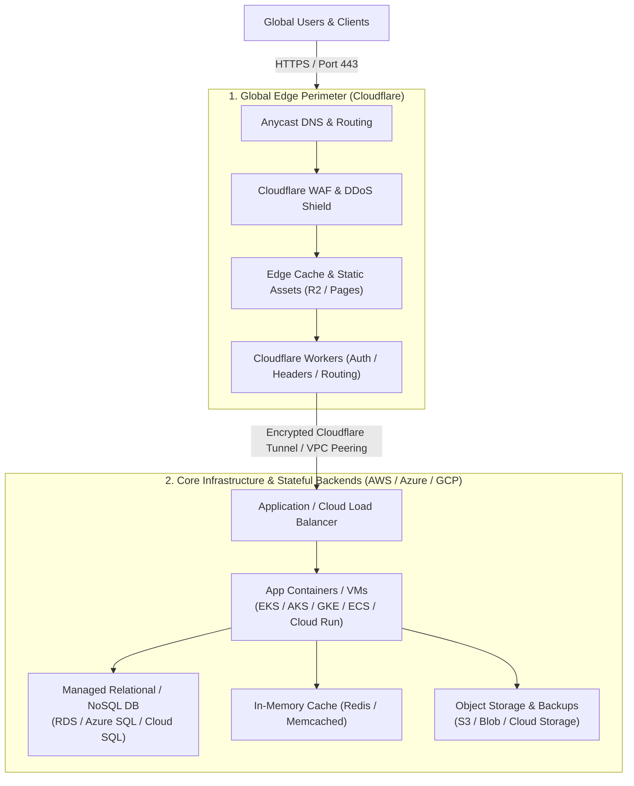

### High-Level Platform Profiles

| Dimension | Amazon Web Services (AWS) | Microsoft Azure | Google Cloud Platform (GCP) | Cloudflare |
| :--- | :--- | :--- | :--- | :--- |
| **Primary Identity** | The pioneer & market-share leader in broad IaaS/PaaS services | Enterprise integration titan & hybrid Windows/Linux cloud | Data intelligence, container pioneer & cloud-native benchmark | Global Anycast network, edge security & serverless pioneer |
| **Launch Year** | 2006 | 2010 | 2008 | 2010 (Workers in 2017) |
| **Core Architecture** | Highly isolated Regions & Multi-AZ availability zones | Paired Regions, Availability Zones & Geographies | Global Software-Defined Andromeda Network, Regions & Zones | 330+ Anycast Edge Data Centers in 120+ countries |
| **Execution Model** | Hypervisor VMs (Nitro), Containers, Event FaaS | Hypervisor VMs, Managed PaaS, MicroVMs, FaaS | Hypervisor VMs, Container-native runtimes, GKE | V8 isolates (instant startup, zero cold starts) |
| **Ideal Workload** | Broad cloud migration, mission-critical systems, enterprise DevOps | Windows/.NET fleets, Active Directory shops, Microsoft 365 synergy | High-throughput analytics, AI/ML pipelines, Kubernetes fleets | JAMstack web apps, API gateways, CDN caching, DDoS defense |

---

## 2. Platform Deep-Dives

---

### 2.1 Amazon Web Services (AWS)

Amazon Web Services represents the most mature and widely adopted public cloud infrastructure in the world. Its architecture emphasizes strict isolation, deep configurability, granular permission controls, and an extensive catalogue spanning more than 200 fully managed services.

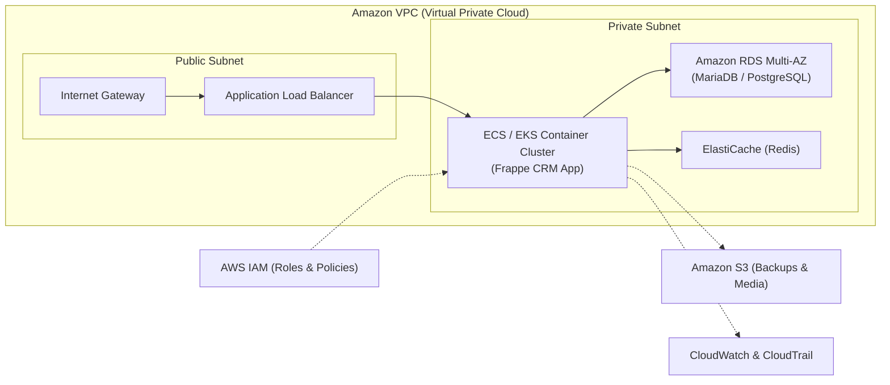

#### Core Services Breakdown

1. **Compute & Orchestration:**
   - **Amazon EC2 (Elastic Compute Cloud):** Provides resizable virtual computing capacity powered by the lightweight AWS Nitro hypervisor system. Features diverse instance families (compute-optimized, memory-optimized, storage-optimized, and ARM-based Graviton processors).
   - **AWS Lambda:** Event-driven, serverless compute engine executing code in response to events (S3 uploads, API Gateway requests, SQS messages) without server provisioning.
   - **Amazon ECS & EKS:** Elastic Container Service (native AWS container management) and Elastic Kubernetes Service (upstream-certified managed Kubernetes), supporting both EC2 worker nodes and AWS Fargate (serverless container compute).

2. **Storage Solutions:**
   - **Amazon S3 (Simple Storage Service):** Industry-standard object storage designed for 99.999999999% (11 9's) data durability, offering intelligent tiering, lifecycle policies, and versioning.
   - **Amazon EBS (Elastic Block Store):** High-performance block storage volumes attached to EC2 instances for transactional file systems and databases.
   - **Amazon EFS (Elastic File System):** Fully managed, elastic NFS file system shareable concurrently across hundreds of EC2 instances and containers.

3. **Database & In-Memory Caching:**
   - **Amazon RDS & Aurora:** Automated relational database services supporting PostgreSQL, MySQL, MariaDB, and Oracle. Aurora delivers MySQL/PostgreSQL compatibility with cloud-native distributed storage and automated 6-way replication.
   - **Amazon DynamoDB:** Fully managed, single-digit millisecond latency NoSQL key-value and document database with built-in global replication and autoscaling.
   - **Amazon ElastiCache:** In-memory caching engine compatible with Redis and Memcached for session management and query acceleration.

4. **Networking & Content Delivery:**
   - **Amazon VPC (Virtual Private Cloud):** Logically isolated software-defined network allowing fine-grained control over subnets, route tables, internet gateways, NAT gateways, and VPC peering.
   - **Route 53 & CloudFront:** Highly available Anycast DNS service and low-latency global Content Delivery Network (CDN) integrating tightly with AWS Shield for DDoS mitigation.
   - **Elastic Load Balancing (ELB/ALB/NLB):** Application Load Balancers for HTTP/HTTPS layer-7 routing and Network Load Balancers for ultra-high-throughput layer-4 TCP/UDP traffic.

5. **Security, Governance & Observability:**
   - **AWS IAM (Identity and Access Management):** Central policy engine governing least-privilege permissions through users, groups, roles, policy documents (JSON), and multi-account AWS Organizations.
   - **AWS KMS & Secrets Manager:** Hardware-backed cryptographic key lifecycle management and automated secret rotation for database credentials and API tokens.
   - **Amazon CloudWatch & AWS CloudTrail:** Full-stack operational monitoring (metrics, dashboards, alarms, log groups) and immutable audit trails of all API calls executed across the AWS account.

6. **DevOps & Infrastructure as Code (IaC):**
   - **AWS CloudFormation & CDK (Cloud Development Kit):** Declarative and imperative IaC allowing infrastructure definitions via YAML/JSON or standard programming languages (TypeScript, Python, Go).
   - **AWS CodePipeline, CodeBuild, CodeDeploy:** Managed continuous integration and continuous delivery toolchain.

#### Real-World Deployment Scenario: Frappe CRM on AWS
A production Frappe CRM deployment on AWS runs inside a private VPC across two Availability Zones:
- **Frontend / Ingress:** Route 53 directs traffic through AWS WAF to an Application Load Balancer (ALB).
- **Application Tier:** Frappe CRM Docker containers run on Amazon ECS (or EKS) utilizing AWS Fargate to eliminate EC2 OS maintenance.
- **Data Tier:** MariaDB/PostgreSQL runs on Amazon RDS Multi-AZ for automatic failover; Celery task queues and caching utilize Amazon ElastiCache (Redis).
- **Asset Storage:** Public and private user uploads are pushed to Amazon S3 using IAM Task Roles for secure, keyless authentication.

#### Key Strengths & Operational Considerations
- **Strengths:** Unrivaled service depth, extensive global partner network, market-leading enterprise security certifications, mature IaC ecosystems (Terraform / CDK).
- **Considerations:** High architectural complexity for beginners; nuanced IAM JSON syntax; complex network design (NAT gateway pricing, cross-AZ transfer charges).

---

### 2.2 Microsoft Azure

Microsoft Azure is engineered as an enterprise-grade cloud platform, distinguished by its seamless integration with Windows Server, Active Directory (Microsoft Entra ID), Microsoft 365, GitHub, and hybrid corporate networks.

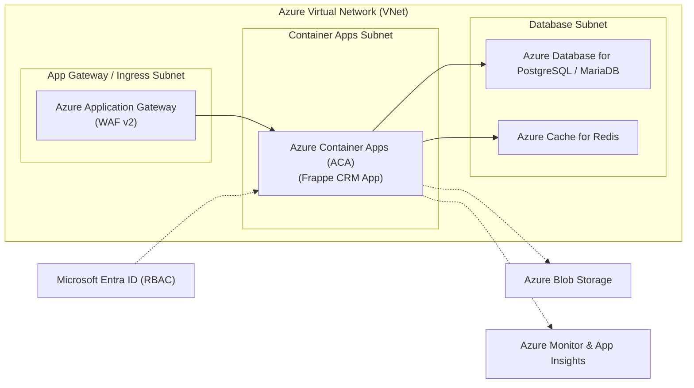

#### Core Services Breakdown

1. **Compute & Application Hosting:**
   - **Azure Virtual Machines:** Standard IaaS computing supporting Linux distributions and Windows Server with specialized sizes (accelerated networking, GPU compute).
   - **Azure App Service:** Fully managed Platform as a Service (PaaS) for deploying web applications and REST APIs without managing web server runtimes.
   - **Azure Container Apps (ACA) & AKS:** Azure Container Apps leverages Kubernetes and KEDA underneath to provide serverless microservice scaling; Azure Kubernetes Service (AKS) delivers enterprise managed Kubernetes clusters.
   - **Azure Functions:** Event-driven serverless compute runtime with deep bindings into Azure Event Grid, Cosmos DB, and Blob Storage.

2. **Storage Ecosystem:**
   - **Azure Blob Storage:** Massively scalable object storage with Hot, Cool, Cold, and Archive storage tiers, supporting data immutability and lifecycle policies.
   - **Azure Managed Disks:** Persistent block storage volumes (Ultra Disk, Premium SSD, Standard SSD) attached to Azure VMs.
   - **Azure Files:** Fully managed enterprise SMB and NFS file shares accessible from cloud instances and on-premises workstations.

3. **Databases & Data Management:**
   - **Azure SQL Database & Flexible Server:** Managed SQL database services providing built-in AI tuning, high availability, and automated point-in-time restores; Flexible Server provides dedicated community PostgreSQL and MySQL engines.
   - **Azure Cosmos DB:** Globally distributed, multi-model NoSQL database offering single-digit millisecond latency with multi-region active-active writes and SLA-backed consistency models.
   - **Azure Cache for Redis:** Managed Redis instance for low-latency session caching and message brokering.

4. **Networking & Traffic Engineering:**
   - **Azure Virtual Network (VNet):** Private network isolation providing subnetting, Network Security Groups (NSGs), route tables, and VNet Peering.
   - **Azure Front Door & Application Gateway:** Front Door acts as a global web application accelerator and CDN with built-in WAF; Application Gateway provides regional layer-7 load balancing with SSL termination.
   - **Azure Private Link:** Private, secure connectivity to Azure PaaS services without routing traffic over the public internet.

5. **Identity, Security & Governance:**
   - **Microsoft Entra ID (formerly Azure Active Directory):** Universal cloud identity and access management system providing Single Sign-On (SSO), Conditional Access, and Multifactor Authentication (MFA).
   - **Azure Role-Based Access Control (RBAC):** Hierarchical governance structure cascading from Management Groups down to Subscriptions, Resource Groups, and individual Resources.
   - **Azure Key Vault & Defender for Cloud:** Centralized secrets/certificates vault coupled with continuous cloud security posture management (CSPM).

6. **DevOps & IaC Tooling:**
   - **Azure DevOps & GitHub Actions:** Comprehensive end-to-end ALM suite (Azure Boards, Repos, Pipelines, Artifacts) alongside deep native GitHub integrations.
   - **Bicep & ARM Templates:** Bicep is Azure's modern, human-readable domain-specific language (DSL) for declarative infrastructure as code, significantly cleaner than raw ARM JSON.

#### Real-World Deployment Scenario: Frappe CRM on Azure
- **Ingress:** Azure Front Door routes incoming traffic through Azure Web Application Firewall (WAF) to an Azure Application Gateway.
- **Compute:** Frappe CRM web and worker containers run on Azure Container Apps (ACA), scaling replicas based on HTTP traffic or Redis queue depth.
- **Database & Cache:** Azure Database for PostgreSQL (Flexible Server) handles relational CRM data, while Azure Cache for Redis orchestrates background Celery jobs.
- **Storage:** Static and private user attachments are preserved in Azure Blob Storage.
- **Governance:** Developers and operators authenticate via Microsoft Entra ID with conditional access enforcing MFA.

#### Key Strengths & Operational Considerations
- **Strengths:** Industry-leading hybrid cloud capabilities (Azure Arc), unrivaled identity governance via Entra ID, clean IaC experience with Bicep, cost-effective licensing models (Azure Hybrid Benefit).
- **Considerations:** Portal UI can feel dense with extensive terminology; distinction between Entra ID directory roles and Azure RBAC resource roles requires initial study.

---

### 2.3 Google Cloud Platform (GCP)

Google Cloud Platform is renowned for its world-class global software-defined network, leadership in container technology (having originated Kubernetes), and exceptional data analytics, streaming, and machine learning infrastructure.

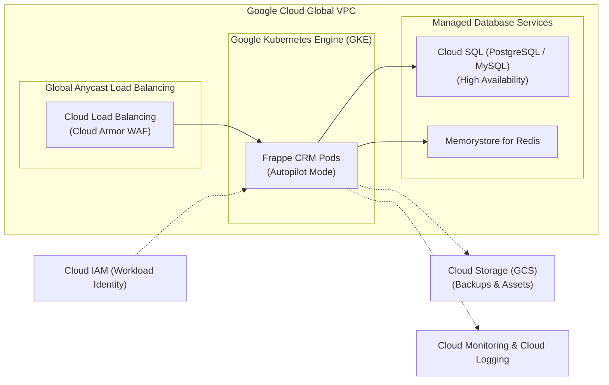

#### Core Services Breakdown

1. **Compute & Container Platforms:**
   - **Google Compute Engine (GCE):** High-speed virtual machine instances running on Google's global infrastructure with custom machine types (choose custom vCPU and RAM ratios to avoid paying for excess capacity).
   - **Google Kubernetes Engine (GKE):** The gold standard for enterprise Kubernetes. Features **GKE Autopilot**, a fully managed operational mode where Google manages the cluster infrastructure, node provisioning, security hardening, and autoscaling.
   - **Cloud Run:** Serverless container platform that automatically scales any stateless container from zero to thousands of instances based on incoming HTTP requests or Pub/Sub events.
   - **Cloud Run Functions (formerly Cloud Functions):** Lightweight, serverless FaaS environment for event-triggered automation.

2. **Storage Services:**
   - **Cloud Storage (GCS):** Unified object storage offering Standard, Nearline, Coldline, and Archive tiers with a single API, strong global consistency, and automatic lifecycle management.
   - **Persistent Disk (PD):** Durable, network-attached block storage for GCE instances and GKE stateful sets (Standard, Balanced, SSD, Extreme).
   - **Filestore:** Managed NFS file storage designed for low-latency shared file access across compute clusters.

3. **Databases, Caching & Analytics:**
   - **Cloud SQL & AlloyDB:** Managed relational databases (PostgreSQL, MySQL, SQL Server) with automated backups and maintenance windows; AlloyDB provides an enterprise PostgreSQL-compatible engine offering up to 4x faster transactional workloads.
   - **Cloud Spanner:** Industry-defining globally distributed relational database delivering external consistency with five 9's (99.999%) SLA availability.
   - **Cloud Firestore & Bigtable:** Firestore provides scalable NoSQL document storage; Cloud Bigtable delivers ultra-low-latency wide-column NoSQL for massive analytical and operational workloads.
   - **Memorystore:** Fully managed in-memory service for Redis and Memcached.
   - **BigQuery:** Serverless, highly scalable multi-cloud data warehouse executing petabyte-scale SQL queries in seconds.

4. **Networking & Global Backbone:**
   - **Global VPC:** Unlike AWS or Azure regional networks, a Google Cloud VPC is inherently global; subnets created across different geographic continents communicate securely over Google’s private fiber backbone without public internet traversal.
   - **Cloud Load Balancing:** Global Anycast single virtual IP routing traffic to the nearest healthy instance worldwide with sub-second failover.
   - **Cloud CDN & Cloud Armor:** Content delivery caching paired with ML-driven DDoS mitigation and enterprise WAF protection based on OWASP Top 10 rules.

5. **Security, Identity & Operations:**
   - **Cloud IAM:** Granular resource permission hierarchy organized logically by Organization -> Folders -> Projects -> Resources.
   - **Workload Identity:** Best-in-class security feature allowing GKE and Cloud Run workloads to assume IAM roles without managing long-lived static JSON service account keys.
   - **Google Cloud Observability (Cloud Logging / Monitoring / Trace):** Built-in logging and metrics telemetry providing real-time log ingestion, trace analysis, and uptime alerting.

6. **DevOps & IaC Tooling:**
   - **Cloud Build & Artifact Registry:** Serverless continuous integration platform coupled with a secure universal package and container registry.
   - **Config Connector & Terraform Provider:** Config Connector enables managing GCP cloud resources declaratively using native Kubernetes CRD manifests.

#### Real-World Deployment Scenario: Frappe CRM on GCP
- **Ingress:** Google Cloud Load Balancing (Single Anycast IP) terminates TLS and protects application endpoints using Cloud Armor.
- **Compute:** Frappe CRM runs on **GKE Autopilot**, ensuring automated node provisioning, vulnerability scanning, and cost-efficient pod-level billing.
- **Database & Cache:** Cloud SQL (PostgreSQL/MySQL) operates in high-availability mode with automated replication across zones; Memorystore for Redis accelerates background queue scheduling.
- **Security:** Pods leverage **GKE Workload Identity** to push and fetch media assets directly to/from private Cloud Storage (GCS) buckets without hardcoded credentials.

#### Key Strengths & Operational Considerations
- **Strengths:** True global VPC networking, unmatched managed Kubernetes experience (GKE), industry benchmark data platform (BigQuery), clean project-based resource hierarchy.
- **Considerations:** Smaller third-party enterprise marketplace footprint compared to AWS; service rebrandings can occasionally cause documentation confusion.

---

### 2.4 Cloudflare

Cloudflare occupies a unique and transformative position in modern cloud computing. It is not an infrastructure clone of the hyperscalers; rather, it is a **Global Edge Connectivity, Security, and Serverless Execution Platform**.

Operating an Anycast network spanning more than 330 cities in over 120 countries, Cloudflare handles roughly 20% of the world's web traffic, placing compute and data storage within 50 milliseconds of 95% of the global connected population.

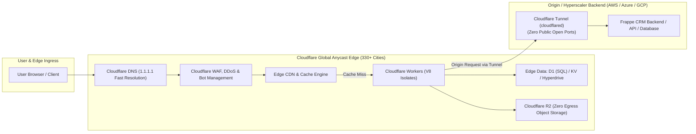

#### Core Services Breakdown

1. **Edge Serverless Compute:**
   - **Cloudflare Workers:** Executes lightweight JavaScript/TypeScript, Rust, and WebAssembly code at the edge. Crucially, Workers run on **Google V8 engine isolates** rather than heavy virtual machines or container runtimes, resulting in **zero cold start latency (<5ms)** and minimal memory overhead.
   - **Cloudflare Pages:** Highly optimized Git-integrated platform for building, hosting, and deploying static websites and full-stack JAMstack applications.
   - **Durable Objects & Workflows:** Provides strongly consistent, stateful compute coordination and durable workflow orchestration directly at the edge.

2. **Edge Storage & Serverless Databases:**
   - **Cloudflare R2:** S3-compatible object storage featuring **zero data egress fees**, making it an exceptionally cost-effective alternative for media assets, public downloads, and backups.
   - **Cloudflare D1:** Serverless relational SQL database built on SQLite, replicated to edge locations for high-performance localized queries.
   - **Workers KV:** Low-latency, globally replicated key-value storage optimized for high-volume read operations.
   - **Hyperdrive:** Connection pooling and query caching accelerator that connects edge Workers to regional PostgreSQL databases hosted on AWS, Azure, or GCP with ultra-low latency.

3. **Global Networking & Connectivity:**
   - **Cloudflare DNS:** Enterprise-grade authoritative DNS service known for blazing speed and instant propagation.
   - **Content Delivery Network (CDN):** Intelligent edge caching that inspects headers, optimizes images, and minimizes origin server load.
   - **Cloudflare Tunnel (`cloudflared`):** Secure outbound daemon establishing encrypted tunnels between private servers and Cloudflare’s edge without opening inbound ports or exposing public IP addresses.

4. **Security, DDoS & Zero Trust:**
   - **Web Application Firewall (WAF) & DDoS Mitigation:** Automatic mitigation of multi-terabit volumetric DDoS attacks and intelligent application-layer filtering against SQL injection and cross-site scripting.
   - **Cloudflare Turnstile:** Privacy-respecting, frictionless alternative to traditional CAPTCHAs.
   - **Cloudflare Zero Trust (Access):** Replaces legacy corporate VPNs with identity-aware perimeter security, allowing authorized developers to access internal admin panels and servers based on SSO identity.

5. **Observability & Developer Experience:**
   - **Wrangler CLI:** Modern, ergonomic command-line interface for scaffolding, developing, testing locally, and deploying Cloudflare Workers and bindings.
   - **Workers Observability & Real-Time Analytics:** Built-in tail logs, invocation traces, and edge request telemetry.

#### The Edge Advantage: Why Cloudflare is Different from Hyperscalers
Unlike AWS, Azure, or GCP, Cloudflare does **not** provide configurable multi-core virtual machines, arbitrary long-running background daemon processes, managed Kubernetes clusters, or multi-terabyte enterprise data warehouses. 

Instead, Cloudflare excels at the **perimeter layer**:
- Serving static assets and CDN caching at the physical edge.
- Inspecting and filtering traffic before it reaches origin infrastructure.
- Executing ultra-low-latency edge logic (A/B testing, auth token validation, geolocation routing).
- Eliminating punitive data egress costs through Cloudflare R2.

#### Real-World Deployment Scenario: Hybrid Frappe CRM Deployment
The optimal modern deployment pattern combines Cloudflare with a hyperscaler backend:
- **Perimeter Security & Ingress:** Cloudflare manages DNS, terminates SSL, enforces WAF rules, and absorbs volumetric DDoS attacks.
- **Secure Origin Connectivity:** A `cloudflared` tunnel runs inside the backend Docker host, exposing Frappe CRM to Cloudflare without assigning a public IP address to the VM or opening port 80/443 to the internet.
- **Media & Backup Storage:** Frappe CRM backups and file uploads are routed to **Cloudflare R2**, eliminating AWS S3 data egress fees when users download files.
- **Internal Admin Protection:** Cloudflare Access (Zero Trust) places the Frappe CRM staging environment and bench console behind team SSO login.

---

## 3. The Hyperscaler vs. Edge Platform Paradigm

A critical conceptual insight in cloud architecture is recognizing the structural differences between traditional hyperscalers (AWS, Azure, GCP) and edge developer platforms (Cloudflare).

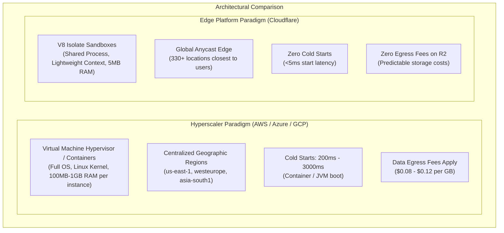

### Architectural Divergence Matrix

| Capability / Factor | Hyperscalers (AWS / Azure / GCP) | Cloudflare Edge Platform |
| :--- | :--- | :--- |
| **Compute Execution Unit** | Hypervisor Virtual Machines, Container Pods, MicroVMs | Lightweight Google V8 Isolates |
| **Execution Lifetime** | Long-running processes, daemons, background workers supported | Millisecond request/response lifecycles (Workflows for longer jobs) |
| **Data Locality** | Data resides in specific designated geographic data center regions | Code and cache run globally across all 330+ Anycast points of presence |
| **Database Engines** | Massive relational engines (PostgreSQL, MariaDB, Oracle, SQL Server) | Lightweight serverless SQLite (D1), Key-Value (KV), or backend proxies |
| **Networking Ingress** | Regional VPCs, Subnets, Gateways, Public Elastic IPs | Zero-IP architecture, Anycast routing, Outbound-only encrypted tunnels |
| **Bandwidth & Egress** | Significant per-gigabyte egress fees when moving data to internet | **Zero data egress fees** on R2 object storage and CDN transit |

---

## 4. Cross-Platform Service Mapping & Functional Equivalents

The following comprehensive matrix provides a direct mapping across equivalent capabilities on AWS, Microsoft Azure, Google Cloud Platform, and Cloudflare.

### Service-Equivalent Overview Diagram

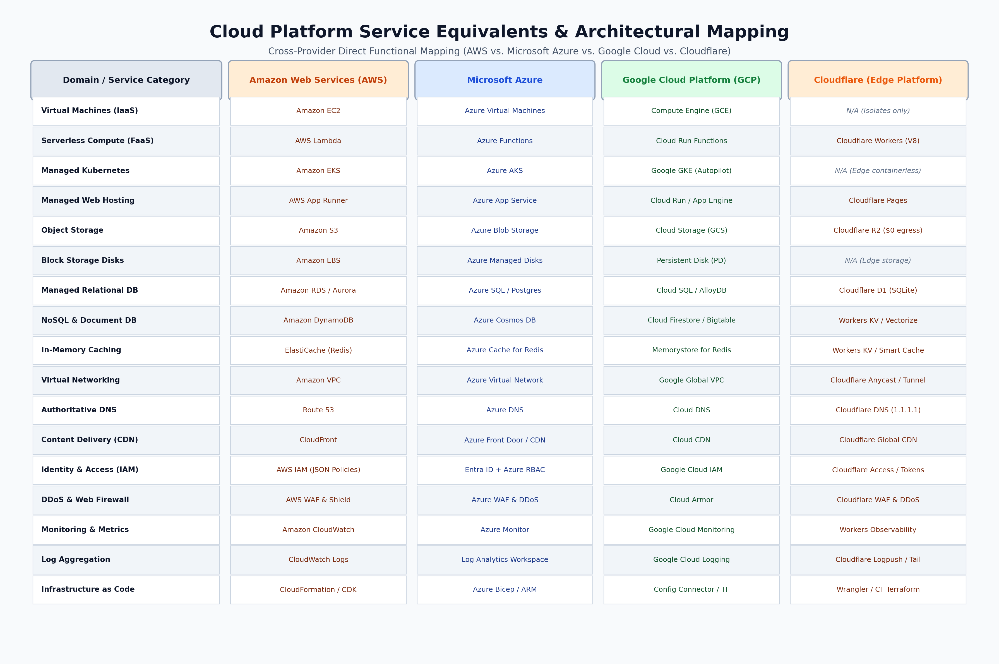

| Service Domain | Amazon Web Services (AWS) | Microsoft Azure | Google Cloud Platform (GCP) | Cloudflare |
| :--- | :--- | :--- | :--- | :--- |
| **Virtual Machines (IaaS)** | Amazon EC2 | Azure Virtual Machines | Compute Engine (GCE) | *No direct VM equivalent* |
| **Container Orchestration** | Amazon ECS / Amazon EKS | Azure Container Apps / AKS | Google Kubernetes Engine (GKE) | *No direct K8s equivalent* |
| **Serverless Compute (FaaS)**| AWS Lambda | Azure Functions | Cloud Run Functions | Cloudflare Workers |
| **Managed Web PaaS** | AWS App Runner / Elastic Beanstalk | Azure App Service | Cloud Run / App Engine | Cloudflare Pages |
| **Object Storage** | Amazon S3 | Azure Blob Storage | Cloud Storage (GCS) | Cloudflare R2 |
| **Persistent Block Disks**| Amazon EBS | Azure Managed Disks | Persistent Disk (PD) | *No direct block disk equivalent* |
| **Shared Network File Storage**| Amazon EFS | Azure Files | Google Filestore | *No direct shared NFS equivalent* |
| **Managed Relational DB** | Amazon RDS / Aurora | Azure SQL / Flexible Server | Cloud SQL / AlloyDB | Cloudflare D1 (Serverless SQLite) |
| **NoSQL Database** | Amazon DynamoDB | Azure Cosmos DB | Cloud Firestore / Bigtable | Cloudflare Workers KV |
| **In-Memory Caching** | Amazon ElastiCache | Azure Cache for Redis | Memorystore for Redis | Workers KV / Smart Cache |
| **Virtual Networking** | Amazon VPC | Azure Virtual Network (VNet) | Google Global VPC | Cloudflare Network & Tunnels |
| **DNS Hosting** | Amazon Route 53 | Azure DNS | Google Cloud DNS | Cloudflare Authoritative DNS |
| **Content Delivery (CDN)**| Amazon CloudFront | Azure Front Door / Azure CDN | Google Cloud CDN | Cloudflare Global CDN |
| **Identity & Access (IAM)**| AWS IAM | Microsoft Entra ID + RBAC | Google Cloud IAM | Cloudflare Access & API Tokens |
| **Secrets & Keys** | AWS Secrets Manager / KMS | Azure Key Vault | Secret Manager / Cloud KMS | Cloudflare Encrypted Secrets |
| **DDoS & Web Firewall (WAF)**| AWS WAF & AWS Shield | Azure WAF & DDoS Protection | Cloud Armor | Cloudflare WAF & DDoS Shield |
| **Observability & Logging** | Amazon CloudWatch / CloudTrail | Azure Monitor / App Insights | Cloud Logging / Monitoring | Workers Observability & Analytics |
| **Infrastructure as Code** | CloudFormation / AWS CDK | Bicep / ARM Templates | Config Connector / Terraform | Wrangler / Cloudflare Terraform |

---

## 5. End-to-End Application Architecture Blueprint

To demonstrate how these services interact in a realistic DevOps scenario, consider deploying an enterprise web application (such as the Frappe CRM / MariaDB / Redis stack investigated in Tasks 1–3).

### Cloud-Neutral Application Architecture Diagram

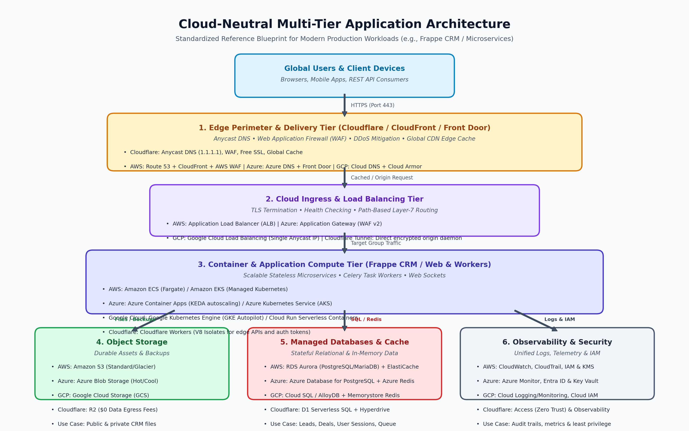

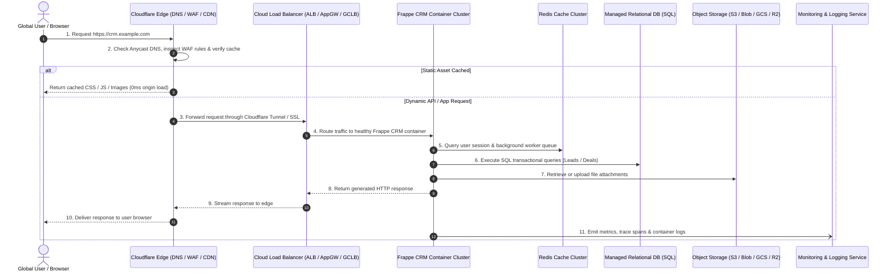

### Layer-by-Layer Architectural Mapping

1. **Perimeter & Edge Tier:**
   - **Cloudflare** acts as the primary public entry point, delivering rapid DNS resolution via Anycast, terminating TLS encryption, blocking malicious payloads via WAF, and serving static assets from edge cache.
2. **Ingress & Load Balancing:**
   - The origin cloud provider utilizes an **Application Load Balancer (AWS ALB, Azure Application Gateway, or Google Cloud Load Balancer)** configured to only accept incoming traffic from Cloudflare IP ranges or an established `cloudflared` tunnel.
3. **Application & Container Compute:**
   - Stateless Frappe CRM web and background worker containers are scheduled via **Amazon ECS/EKS, Azure Container Apps, or Google Kubernetes Engine (GKE)**, scaling automatically based on traffic volume and CPU utilization.
4. **Caching & Queue Management:**
   - **ElastiCache, Azure Cache for Redis, or Cloud Memorystore** maintains session state, handles real-time socket pub/sub, and powers asynchronous background task queues.
5. **Persistent Data Tier:**
   - Transactional business data (leads, pipelines, contacts) is safely persisted in a managed SQL database **(AWS RDS Aurora, Azure Database Flexible Server, or GCP Cloud SQL)** configured with multi-AZ failover and automated daily backups.
6. **Object & Media Storage:**
   - User document attachments, exports, and automated database backup archives are safely stored in **S3, Azure Blob, GCS, or Cloudflare R2**.
7. **Observability & Operational Auditing:**
   - Container stdout logs and system health telemetry are continuously ingested into **CloudWatch, Azure Monitor, or Google Cloud Logging** with automated alerts triggered when container error rates or memory thresholds exceed acceptable limits.

---

## 6. Beginner-Friendliness & Operational Ergonomics

When learning cloud computing, each platform presents distinct user experiences, configuration paradigms, and learning barriers.

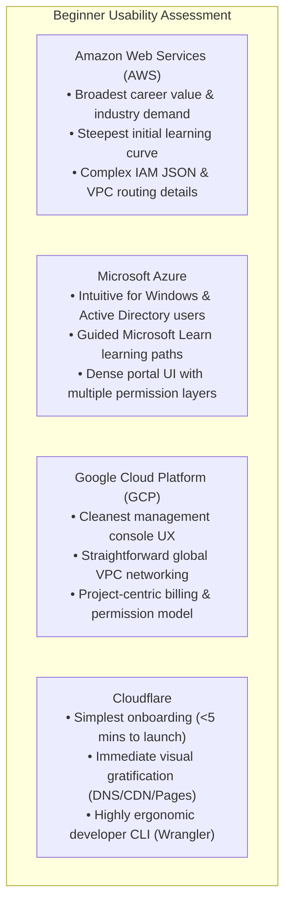

### Comparative Usability Breakdown

| Evaluation Factor | Amazon Web Services (AWS) | Microsoft Azure | Google Cloud Platform (GCP) | Cloudflare |
| :--- | :--- | :--- | :--- | :--- |
| **Management Console UX** | Functional, highly detailed, but occasionally fragmented across service generations | Modern blade-based navigation; visually rich but can feel horizontally cluttered | Clean, responsive, and logically structured; project-oriented switcher | Exceptionally clean, modern, and focused; zero clutter |
| **CLI Ergonomics** | Powerful (`aws` CLI v2), but parameter-heavy with complex JSON query filters | Extensive (`az` CLI), predictable syntax with built-in `--output table` options | Highly intuitive (`gcloud`), excellent interactive prompts and tab completion | Incredibly fast (`wrangler`), delightful developer experience for code & deploy |
| **Identity & Security Model** | Granular IAM JSON policies; powerful but easy for beginners to misconfigure | Entra ID (directory) + Azure RBAC (resources); dual-layer requires initial study | Simple hierarchy: Org -> Folder -> Project -> IAM Roles; clear and intuitive | Simple account tokens, Zero Trust Access policies; very straightforward |
| **Networking Simplicity** | Explicit VPCs, subnets, route tables, and NAT gateways must be configured manually | VNets and Subnets require careful IP planning; Network Security Groups are easy | **Global VPC by default**; subnets route globally without complex peering | **Zero network management**; DNS proxying works with a single orange-cloud toggle |
| **Common Beginner Pitfalls** | Leaving NAT Gateways or unattached Elastic IPs running ($$$); IAM syntax errors | Confusing Resource Group permissions with Entra ID roles; VM disk sizing | Forgetting to associate billing accounts to projects; misunderstanding quotas | Expecting full Node.js or Python VM runtimes in lightweight V8 Workers |

---

## 7. Learning Path Decision Framework

To determine which platform a beginner should learn first, follow this contextual decision framework:

### Beginner Platform Decision Tree

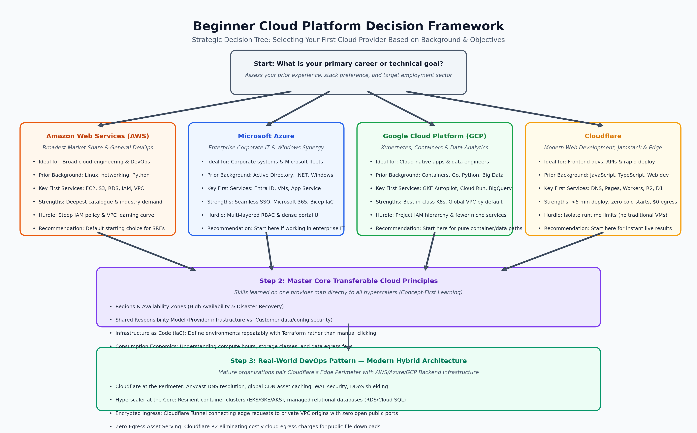

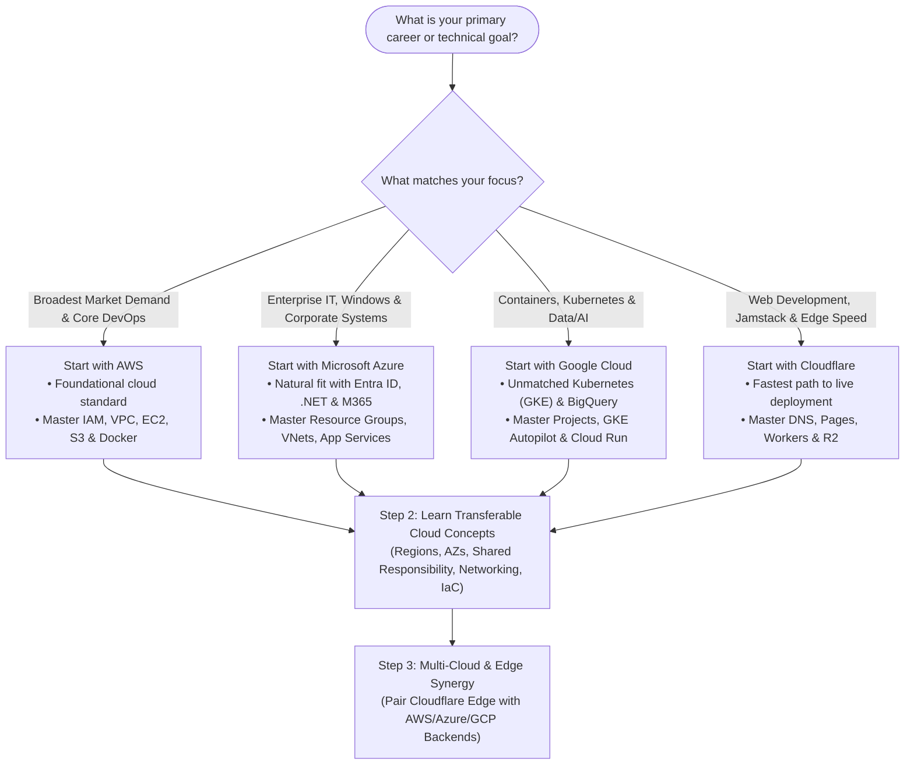

### Strategic Recommendations by Role

1. **For Aspiring DevOps & Site Reliability Engineers (SREs):**
   - **Recommended Choice:** **AWS** or **Google Cloud (GCP)**.
   - **Rationale:** AWS has the highest market share and job postings. GCP provides the gold-standard Kubernetes environment (GKE), which is foundational for modern microservice orchestration.
2. **For Enterprise Systems Administrators & Windows Engineers:**
   - **Recommended Choice:** **Microsoft Azure**.
   - **Rationale:** Azure is the natural cloud extension for enterprises running Active Directory, Windows Server, and Office 365.
3. **For Frontend Developers, JAMstack Enthusiasts & Fast Prototypers:**
   - **Recommended Choice:** **Cloudflare**.
   - **Rationale:** Cloudflare Pages and Workers eliminate infrastructure friction, allowing you to deploy live, globally distributed applications in under five minutes with zero operational overhead.

---

## 8. Zero-Cost Exploration & Billing Safeguards

> **CRITICAL DIRECTIVE:** Task 4 is an exploration and learning task. **Do not create paid cloud resources or make any purchases.**

Each cloud platform provides free tier options and evaluation credits. However, accidental billing can occur if resources are provisioned outside free quotas. Follow these strict operational safeguards:

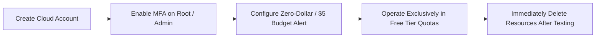

### Free Tier Comparison Overview

| Platform | Free Tier Offering Structure | Key Always-Free Capabilities | Critical Billing Hazard to Avoid |
| :--- | :--- | :--- | :--- |
| **AWS** | • 12 Months Free (new accounts) • Always Free tier • Short-term free trials | • 750 hrs/mo `t2.micro` or `t3.micro` EC2 • 5 GB S3 Standard Storage • 1,000,000 free AWS Lambda requests/mo | **NAT Gateways** ($0.045/hr + data), unattached Elastic IPs, provisioned IOPS disks. |
| **Microsoft Azure** | • $200 free credit (first 30 days) • 12 months of popular free services • 55+ always-free services | • 750 hrs/mo B1s Linux/Windows VM • 5 GB Azure Blob Storage • 100,000 Azure Functions executions/mo | Keeping VMs running after credits expire, provisioned premium SSDs, unmanaged snapshots. |
| **Google Cloud (GCP)**| • $300 free trial credits (90 days) • 20+ always-free products | • 1 `e2-micro` VM per month (US regions) • 5 GB Cloud Storage standard • 2,000,000 Cloud Run requests/mo | Forgetting to delete test GKE clusters, leaving Cloud SQL instances running continuously. |
| **Cloudflare** | • **Permanently Free Tier** (no credit card required for basic services) | • Unlimited DNS records • Free Global CDN & DDoS Protection • 100,000 Worker requests/day • 10 GB/mo free R2 storage | Enabling paid add-on features (Advanced Certificate Manager, paid WAF rulesets). |

### 10-Point Safe Cloud Exploration Checklist

- [ ] **1. Multi-Factor Authentication (MFA):** Immediately secure the root/admin account using hardware or app-based authenticator (Google Authenticator, Bitwarden).
- [ ] **2. Establish Zero-Dollar / Low-Threshold Budget Alerts:**
  - *AWS:* Open **AWS Budgets** and configure a Cost Budget at `$1.00` or `$5.00` with instant email notification.
  - *Azure:* Navigate to **Cost Management + Billing -> Cost Alerts** and create a budget alert.
  - *GCP:* Go to **Billing -> Budgets & alerts** and set a budget of `$1.00` with 50%, 90%, and 100% threshold triggers.
- [ ] **3. Never Commit Cloud Credentials:** Never paste AWS Access Keys, Azure Service Principal secrets, or GCP service account JSON files into public or private GitHub repositories. Use `.gitignore` and tools like `git-secrets` or `trufflehog`.
- [ ] **4. Stick to Free Instance Types:**
  - AWS: Only deploy `t2.micro` or `t3.micro`.
  - Azure: Only deploy `Standard_B1s`.
  - GCP: Only deploy `e2-micro` in `us-central1`, `us-east1`, or `us-west1`.
- [ ] **5. Beware of NAT Gateways:** On AWS and GCP, managed NAT Gateways incur immediate hourly charges even if zero traffic passes through them. For testing, place test VMs in public subnets with security group rules instead.
- [ ] **6. Audit and Delete Orphaned Disks:** Terminating a virtual machine often leaves its root and attached block storage disks (EBS, Managed Disk, Persistent Disk) active and accumulating storage costs.
- [ ] **7. Tear Down Load Balancers When Finished:** Cloud load balancers (ALBs, Application Gateways) incur continuous hourly rates while provisioned.
- [ ] **8. Keep Object Buckets Private:** Ensure S3 buckets, Azure containers, and GCS buckets have "Block Public Access" enabled unless explicitly testing static asset delivery.
- [ ] **9. Check Egress Bandwidth:** Moving large multi-gigabyte files out of hyperscalers to the public internet incurs bandwidth egress charges ($0.08–$0.12/GB). Cloudflare R2 has $0 egress.
- [ ] **10. Post-Exploration Teardown Routine:** At the end of every hands-on learning session, execute a resource audit and delete all experimental resource groups, instances, and databases.

---

## 9. Official Documentation & Learning Resources

Below is a curated collection of official documentation, structured learning paths, and recognized certification roadmaps for each platform:

### 1. Amazon Web Services (AWS)
- **Official Documentation:** [AWS Documentation Hub](https://docs.aws.amazon.com/)
- **Getting Started Guides:** [AWS Getting Started Resource Center](https://aws.amazon.com/getting-started/)
- **Cross-Cloud Comparison:** [AWS to Azure & GCP Service Comparison Guide](https://aws.amazon.com/compare/)
- **Interactive Training:** [AWS Skill Builder (Free digital learning modules)](https://skillbuilder.aws/)
- **AWS Free Tier Directory:** [AWS Free Tier Terms and Limits](https://aws.amazon.com/free/)
- **Foundational Certification:** *AWS Certified Cloud Practitioner (CLF-C02)* followed by *AWS Certified Solutions Architect – Associate (SAA-C03)*.

### 2. Microsoft Azure
- **Official Documentation:** [Microsoft Azure Documentation](https://learn.microsoft.com/en-us/azure/)
- **Interactive Learning Path:** [Microsoft Learn — Azure Fundamentals (AZ-900)](https://learn.microsoft.com/en-us/training/paths/microsoft-azure-fundamentals-describe-cloud-concepts/)
- **Architecture Center:** [Azure Architecture Center Best Practices](https://learn.microsoft.com/en-us/azure/architecture/)
- **Azure Free Account Hub:** [Azure Free Services Directory](https://azure.microsoft.com/en-us/free/)
- **Foundational Certification:** *Microsoft Certified: Azure Fundamentals (Exam AZ-900)* followed by *Azure Administrator Associate (AZ-104)*.

### 3. Google Cloud Platform (GCP)
- **Official Documentation:** [Google Cloud Documentation Portal](https://cloud.google.com/docs)
- **Cross-Cloud Comparison:** [Google Cloud to AWS & Azure Service Equivalents](https://cloud.google.com/docs/get-started/aws-azure-gcp-service-comparison)
- **Interactive Hands-On Labs:** [Google Cloud Skills Boost (formerly Qwiklabs)](https://www.cloudskillsboost.google/)
- **Architecture Framework:** [Google Cloud Architecture Framework](https://cloud.google.com/architecture/framework)
- **Foundational Certification:** *Google Cloud Digital Leader* followed by *Associate Cloud Engineer (ACE)*.

### 4. Cloudflare
- **Official Documentation:** [Cloudflare Developer Documentation](https://developers.cloudflare.com/)
- **Workers Quickstart:** [Cloudflare Workers Get Started Guide](https://developers.cloudflare.com/workers/get-started/guide/)
- **Pages Deployment:** [Cloudflare Pages Documentation](https://developers.cloudflare.com/pages/)
- **Zero Trust & Security:** [Cloudflare Zero Trust Architecture Guide](https://developers.cloudflare.com/cloudflare-one/)
- **Object Storage (R2):** [Cloudflare R2 Documentation](https://developers.cloudflare.com/r2/)

---

## 10. Strategic Conclusion & Key Takeaways

1. **Cloud Computing is Concept-First, Syntax-Second:**
   - While service names vary (EC2 vs. Azure VM vs. Compute Engine; S3 vs. Blob vs. Cloud Storage), the fundamental architectural primitives—virtual networking, compute virtualization, block vs. object storage, relational persistence, and identity governance—are universally transferable across all hyperscalers.
2. **Cloudflare Redefines the Edge:**
   - Cloudflare is not trying to replace hyperscalers for relational databases or large Kubernetes clusters. Instead, it dominates the **edge computing, application security, and content delivery tier**. In modern DevOps, Cloudflare functions as the intelligent front-door that shields and accelerates core backend workloads running on AWS, Azure, or GCP.
3. **The Multi-Cloud Reality:**
   - Real-world organizations rarely select a single provider purely on brand loyalty. Instead, workloads are matched to specific platform strengths:
     - **AWS** for comprehensive ecosystem depth, broad enterprise software support, and mature DevOps tooling.
     - **Azure** for frictionless integration with existing corporate Windows fleets, Active Directory, and Microsoft 365.
     - **Google Cloud** for cloud-native microservices running on GKE, data engineering, and petabyte-scale analytics via BigQuery.
     - **Cloudflare** for edge performance, zero-egress asset distribution via R2, DDoS protection, and frictionless global DNS.
4. **DevOps Engineering Approach:**
   - A skilled DevOps engineer abstracts underlying cloud variance by mastering **standard open-source tools**—Docker, Kubernetes, Linux, Git, and Terraform. By defining infrastructure as code and packaging applications into portable containers, modern engineering teams retain architectural freedom, prevent vendor lock-in, and deploy reliably across any cloud environment.

---

## 11. Appendix: Loom Video Walkthrough Guide

To fulfill the Loom video deliverable for Task 4, a structured 4-to-5 minute presentation script is provided in [`LOOM_RECORDING_SCRIPT.md`](LOOM_RECORDING_SCRIPT.md).

### Quick Video Structure Summary:
- **0:00 - 0:45 | Introduction & Scope:** Present yourself (Gourob Das), introduce the objective of exploring AWS, Azure, GCP, and Cloudflare for DevOps workloads, and highlight the distinction between Hyperscalers and Edge platforms.
- **0:45 - 2:00 | The Four Cloud Platforms:** Walk through AWS (scale & depth), Azure (enterprise & Entra ID), GCP (containers & GKE), and Cloudflare (Anycast edge & zero cold starts).
- **2:00 - 3:15 | Cross-Cloud Service Equivalents & Frappe CRM Architecture:** Show the comparison table and explain how a real-world multi-tier application (Frappe CRM) connects Cloudflare edge security to compute, databases, and object storage.
- **3:15 - 4:15 | Beginner Usability & Decision Framework:** Discuss where beginners should start based on their career path, highlighting console ergonomics and common pitfalls.
- **4:15 - 5:00 | Free Tier Safety & Conclusion:** Emphasize zero-cost exploration practices (budget alerts, MFA, cleanup) and conclude with key takeaways.

---
**Document Status:** Complete & Verified  
**Author:** Gourob Das (`gourobdas0103`)  
**Task 4 Submission:** PearlThoughts DevOps Internship
